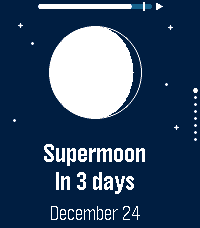
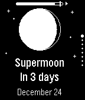
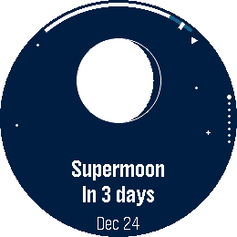
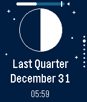
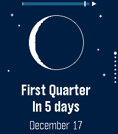
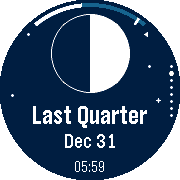

<div align="center">

# 🌙 Moon Phase

**See the Moon exactly as it looks in the sky tonight, right on your wrist.**

[](https://apps.repebble.com/86a2d34ade9646dfb84d51af)
[](https://github.com/loxK/Pebble-Moon-Phase/releases/latest)
[](https://github.com/loxK/Pebble-Moon-Phase/releases/latest/download/moon-phase.pbw)
[](https://github.com/loxK/Pebble-Moon-Phase/actions/workflows/build.yml)
[](LICENSE)



</div>

Moon Phase draws the Moon the way you'd actually see it: the real illuminated shape, oriented for your hemisphere. Then it tells you what's next and when. Everything on screen is computed on the watch; the phone only tells it the hemisphere and fills your timeline.

## Get it

- 📲 **[Install from the Pebble App Store](https://apps.repebble.com/86a2d34ade9646dfb84d51af)**, the easy way.
- ⬇️ Or grab the latest **[`moon-phase.pbw`](https://github.com/loxK/Pebble-Moon-Phase/releases/latest/download/moon-phase.pbw)** and sideload it.
- 📝 What changed in each version: [`CHANGELOG.md`](CHANGELOG.md).

## Features

- 🌒 **The real Moon**: the current phase drawn as a crisp disc, lit exactly like the sky above you.
- ⏳ **Next phase, at a glance**: *“In 4 days”* and the date, front and center.
- 📜 **What's coming**: press **DOWN** (or swipe up on a touch screen) to slide through the upcoming new, first‑quarter, full and last‑quarter phases, one card each, with their date and time.
- 🧭 **Hemisphere aware**: the crescent flips for the Southern hemisphere, set automatically from your location.
- 🌍 **Speaks your language**: English, French, German, Spanish, Italian, Portuguese and Chinese, with local date formats.
- 📏 **How far away**: a gauge across the top fills as the Moon comes closer, an arrow tells whether it is approaching, and a full moon within 360,000 km (the tick on the gauge) is called out as a **supermoon**.
- 🗓️ **In your Timeline**: upcoming phases, perigees and apogees show up as pins; perigees, apogees and supermoons give their distance.
- 🎯 **Accurate & offline**: a proper astronomical model, good to the second.

## Screenshots

<div align="center">

&nbsp;&nbsp;

&nbsp;&nbsp;


<sub>Black &amp; white · Pebble Time 2 · round: one app, every Pebble.</sub>

<br><br>


&nbsp;&nbsp;

&nbsp;&nbsp;


<sub>Slide through the phases, each with its date and time; the gauge tracks the distance.</sub>

</div>

## Plugin for watchfaces and apps

Moon Phase ships a phone-side plugin, so any watchface or app can show the Moon without computing it. Once Moon Phase is installed, subscribe from PebbleKit JS; no permission is needed.

```js
Pebble.subscribeToSource({
  category: 'moon',
  item: 'now',
  onData: function (envelope) {
    var moon = envelope.instances[0].properties;
    console.log(moon.waxing.shortText.text + ', ' + moon.distance.shortText.text);
  },
});
```

**`moon/now`**: the Moon at this moment, one instance, read every 15 minutes.

| Property | Shapes | Value |
|---|---|---|
| `waxing` | `boolean`, `shortText` | Whether the lit part grows ("Waxing", "Waning"). |
| `lunation` | `numericValue` | Position in the lunation, from 0 (new) through 0.5 (full) to 1. |
| `age` | `numericValue` | Days since the last new moon. |
| `distance` | `numericValue`, `shortText` | Earth-Moon distance in km, and in words ("Far"). |
| `approaching` | `boolean`, `shortText` | Whether the Moon is coming closer ("Toward perigee"). |
| `ascending` | `boolean`, `shortText` | Whether the Moon passes higher in the sky each day ("Ascending"), for the hemisphere of the phone. |
| `next_phase` | `shortText`, `timestamp` | The next principal phase, its name and time (seconds). |

**`moon/event`**: what comes over the next 30 days, soonest first, then the next lunar eclipse however far, read every hour. Each instance has a `kind`, a `name` and a `time`; phases, perigees and apogees add a `distance`, eclipses a `shadow`.

| Property | Shapes | Value |
|---|---|---|
| `kind` | `longText` | `new_moon`, `first_quarter`, `full_moon`, `last_quarter`, `perigee`, `apogee`, `ascending_node`, `descending_node`, `highest`, `lowest` or `lunar_eclipse`. |
| `name` | `shortText` | The event in words ("Full Moon", "Supermoon", "Partial eclipse"). |
| `time` | `timestamp`, `shortText`, `longText` | Its time in seconds, its time of day, and its full date. |
| `distance` | `numericValue`, `shortText` | As in `moon/now`, at that instant. |
| `shadow` | `numericValue`, `shortText` | Share of the Moon's diameter in the Earth's shadow, in percent. |

Texts follow the language of the phone. The hemisphere and the 12 or 24-hour clock are those Moon Phase last stored, so open the app once after installing it.

## Build from source

```sh
pebble build
pebble install --emulator emery      # try it in the emulator
pebble install --phone <ip>          # install to your watch
```

Press **DOWN** and **UP** to move between the upcoming phases; on a touch screen, swipe up and down. Long‑press **SELECT** to flip the hemisphere by hand, when the phone cannot tell it: touch has no long press, so that one needs the button.

## Download & verify

Every [release](https://github.com/loxK/Pebble-Moon-Phase/releases/latest) ships the compiled `moon-phase.pbw` together with its **SHA-256** (`moon-phase.pbw.sha256`). It's the same build that's published to the Pebble App Store, so you can confirm the file you got is authentic and untampered:

```sh
sha256sum -c moon-phase.pbw.sha256        # -> moon-phase.pbw: OK
```

The checksum is also printed in each release's notes. Releases after 1.2.0 also carry a build provenance attestation signed by GitHub, which ties the file to the workflow run and the commit that produced it:

```sh
gh attestation verify moon-phase.pbw --repo loxK/Pebble-Moon-Phase
```

## Releases

Every push to `main` and every pull request builds the watchapp. Pushing a tag `vX.Y.Z` builds it again, attests its provenance and publishes a GitHub release with the `.pbw`, its checksum and the matching section of [`CHANGELOG.md`](CHANGELOG.md). The tag has to match the version in `package.json`, and the changelog needs a `## X.Y.Z` section. That `.pbw` is the one published on the Pebble App Store.

## License

Copyright © 2026 Laurent Dinclaux &lt;laurent@knc.nc&gt;

Released under the **GNU Affero General Public License v3.0 or later** (AGPL‑3.0‑or‑later). See [`LICENSE`](LICENSE).

---

Built with 🥥 and ☕ by Lox — Kanaky-New Caledonia 🇳🇨
